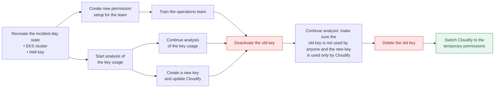

# Getting Out of AWS Day 2 Security Swamp and Survive It

*Technical Reference Document*

**The H@ck Summit 2026** — Warsaw, November 5–6, 2026

**Karolina**  
AWS Security Architect · Trek2Summit / AWS Community

This repository contains all supporting materials for the talk "Getting Out of AWS Day 2 Security Swamp and Survive It" — a real-world case study about discovering shared long-term IAM credentials published on a company's Confluence page, and the parallel remediation strategy that followed.

The talk covers:

- How a single shared IAM key became a critical security vulnerability
- A three-workstream remediation approach (key rotation, alternative authentication, training)
- The organizational challenges that proved harder than the technical fixes

## 📂 Repository Structure

```
├── README.md                          # This file
├── access-setup/
│   ├── iam-identity-center.md         # IAM Identity Center setup guide (console + CLI)
│   ├── eks-access-entries.md          # EKS access entries configuration guide
│   ├── console-access-guide.md        # AWS Console access walkthrough
│   ├── cli-access-guide.md            # AWS CLI SSO configuration guide
│   ├── policies.md                    # LimitedWorkingAccess permission set docs
│   └── limited-working-access.json    # LimitedWorkingAccess inline policy JSON
├── cluster-setup/
│   ├── eks-and-storage.md             # EKS cluster + storage (VPC, nodes, EBS CSI)
│   ├── namespaces.yaml                # cicd-apps / cicd-data / cicd-tooling
│   ├── storage-class.yaml             # ebs-gp3 StorageClass
│   ├── pvc-dynamic.yaml               # dynamically provisioned PVC
│   ├── pod-with-pvc.yaml              # pod mounting the PVC
│   └── deployment-stateless.yaml      # stateless demo Deployment + Service
├── kubernetes/
│   ├── README.md                      # ops-engineers RBAC docs (view + restart + PVCs)
│   ├── cluster-role.yaml              # ops-limited-access ClusterRole
│   └── cluster-role-binding.yaml      # ops-limited-access-binding ClusterRoleBinding
├── iam-keys/
│   ├── iam-keys-setup.md              # Create demo IAM user + static key (SETUP)
│   └── iam-keys-rotation.md           # Rotate: new key → deactivate → delete old
├── cloudtrail-analysis/
│   └── cloudtrail-analysis.md         # CloudWatch Logs Insights queries + guide
├── cloudify/
│   └── temporary-credentials.md       # Cloudify temporary credentials guide
└── docs/
    ├── the-story.md                   # The incident story — context for the walkthrough
    ├── risk-assessment.md             # Risk assessment document
    ├── lessons-learned.md             # Lessons learned
    └── change-management.md           # Organizational change management tips
```

## 🧭 Technical Walkthrough

This is the end-to-end order to run the demo.

> 📖 **Read this first:** [The Story](docs/the-story.md) — the real-world incident
> this walkthrough reproduces and remediates. It explains the *why* behind every
> step below.




> Note: Cloudify is mentioned in the diagram only to give additional context. We are not going to set up a Cloudify instance or create Cloudify blueprints in the walkthrough.

### Assumptions

- You have an AWS account that is a **member of an AWS Organization**.
- You have **AdministratorAccess** to that member account **and** to the
  Organization's **management account** (IAM Identity Center is administered from
  the management account).
- AWS CLI v2 and `kubectl` are installed locally.

> ⚠️ Run this in a **sandbox/throwaway** account. SETUP deliberately creates the
> insecure pattern (admin IAM user + static keys) that REMEDIATION then removes.

---

### Phase 1 — SETUP & ANALYSIS

Build the environment, then recreate the incident.

| # | Do this | Guide |
|---|---------|-------|
| 1 | **Create the EKS cluster and cluster resources** — VPC, subnets, security group, node group, EBS CSI driver, then namespaces, StorageClass, PVC, and a demo workload. | [cluster-setup/eks-and-storage.md](cluster-setup/eks-and-storage.md) |
| 2 | **Create the IAM user and access keys (demo)** — the admin user with a long-term static key that stands in for the leaked "installation key". | [iam-keys/iam-keys-setup.md](iam-keys/iam-keys-setup.md) |
| 3 | **Start CloudTrail analysis for the old key** — begin tracking the key's activity **as soon as it's created**, so you have a full usage history before any rotation. | [cloudtrail-analysis/cloudtrail-analysis.md](cloudtrail-analysis/cloudtrail-analysis.md) |

At the end of SETUP you have a running cluster and a long-term admin key actively
making calls — i.e. the problem state — and CloudTrail already watching that key.

---

### Phase 2 — REMEDIATION

Run these in order. The guiding rule: **build the alternative access first, then
rotate the old key away** — never remove the old key before engineers can work
without it.

| # | Step | What you do | Guide |
|---|------|-------------|-------|
| 1 | **Permission set setup** | Create the `LimitedWorkingAccess` permission set (ReadOnlyAccess + scoped inline policy) in IAM Identity Center. This is the alternative access that must exist **before** the old key is removed. | [access-setup/policies.md](access-setup/policies.md) · [access-setup/iam-identity-center.md](access-setup/iam-identity-center.md) |
| 2 | **Kubernetes role setup** | Apply the `ops-limited-access` ClusterRole + binding (view via the managed access policy; restart deployments and manage PVCs via RBAC). | [kubernetes/README.md](kubernetes/README.md) |
| 3 | **Access config setup** | Create the EKS access entry mapping the SSO role to the `ops-engineers` group and associate the view access policy. | [access-setup/eks-access-entries.md](access-setup/eks-access-entries.md) |
| 4 | **Training: SSO login + testing** | Have an operations engineer log in via SSO (console + CLI) and verify they can do their job with temporary credentials — no static keys. Do this **before** rotation so the team is comfortable on the new setup and nobody gets blocked. | [access-setup/console-access-guide.md](access-setup/console-access-guide.md) · [access-setup/cli-access-guide.md](access-setup/cli-access-guide.md) |
| 5 | **IAM key rotation** | Only after the team is trained and working via SSO: create a new key, switch to it, deactivate then delete the old key. Use the CloudTrail analysis you started in SETUP to prove the old key is unused **before** deleting it. | [iam-keys/iam-keys-rotation.md](iam-keys/iam-keys-rotation.md) · [cloudtrail-analysis/cloudtrail-analysis.md](cloudtrail-analysis/cloudtrail-analysis.md) |

By the end of REMEDIATION, the shared static key is gone and every engineer uses
individual, auto-expiring SSO credentials — the outcome the talk is about.

---

## ⚠️ Disclaimer

All examples use placeholder values (account IDs, ARNs, URLs). Replace with your own values before use. This is educational material based on a real incident — details have been anonymized.

## 📚 Technical Walkthrough Contents

The hands-on guides, in the order the [walkthrough](#-technical-walkthrough) runs them:

### Setup

- [EKS cluster & storage setup](cluster-setup/eks-and-storage.md)
- [IAM user & access key — initial setup](iam-keys/iam-keys-setup.md)

### Remediation

- [CloudTrail log analysis](cloudtrail-analysis/cloudtrail-analysis.md)
- [IAM permission set: LimitedWorkingAccess](access-setup/policies.md)
- [IAM Identity Center setup](access-setup/iam-identity-center.md)
- [Kubernetes RBAC configuration](kubernetes/README.md)
- [EKS access entries](access-setup/eks-access-entries.md)
- [AWS Console access guide](access-setup/console-access-guide.md)
- [AWS CLI SSO guide](access-setup/cli-access-guide.md)
- [IAM access key rotation](iam-keys/iam-keys-rotation.md)


## 📖 Additional Content

Background, context, and supporting material:

- [The Story — context behind the walkthrough](docs/the-story.md)
- [Risk assessment](docs/risk-assessment.md)
- [Cloudify temporary credentials](cloudify/temporary-credentials.md)
- [Lessons learned](docs/lessons-learned.md)
- [Change management](docs/change-management.md)
