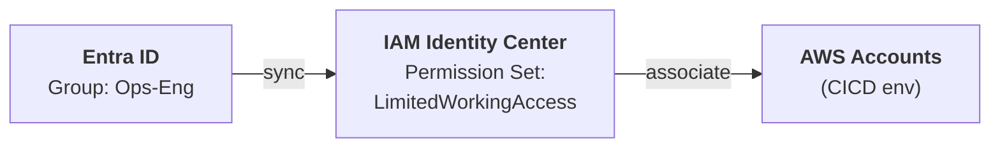

# 🏢 IAM Identity Center Setup Guide

## Architecture



## Prerequisites

- AWS IAM Identity Center enabled in your management account
- Entra ID (Azure AD) configured as the identity source
- SCIM provisioning enabled for automatic group sync
- Administrative access to IAM Identity Center

## Step 1: Create the Entra ID Group

In Microsoft Entra ID (Azure Portal):

1. Navigate to Groups → New group
2. Group type: Security
3. Group name: AWS-Ops-Engineers (or your naming convention)
4. Add the operations engineers as members
5. Save

> *Note: If SCIM provisioning is configured, this group will automatically sync to IAM Identity Center within a few minutes.*

## Step 2: Verify Group Sync in IAM Identity Center

1. Navigate to IAM Identity Center → Groups
2. Search for AWS-Ops-Engineers
3. Verify the group appears and members are correct

## Step 3: Create the Permission Set

1. Navigate to IAM Identity Center → Permission sets
2. Click Create permission set
3. Select Custom permission set
4. Configure:

| **Setting**          | **Value**                                                           |
|----------------------|---------------------------------------------------------------------|
| Name                 | LimitedWorkingAccess                                                |
| Description          | Read-only access with limited write permissions for CICD operations |
| Session duration     | 4 hours                                                             |
| AWS managed policies | ReadOnlyAccess                                                      |
| Inline policy        | Paste the JSON policy content                  |

### Inline policy content

```json
{
  "Version": "2012-10-17",
  "Statement": [
    {
      "Sid": "EKSOperationsAccess",
      "Effect": "Allow",
      "Action": [
        "eks:AccessKubernetesApi"
      ],
      "Resource": "arn:aws:eks:*:*:cluster/cicd-*"
    },
    {
      "Sid": "CloudWatchLogsAccess",
      "Effect": "Allow",
      "Action": [
        "logs:GetLogEvents",
        "logs:FilterLogEvents",
        "logs:StartQuery",
        "logs:GetQueryResults",
        "logs:DescribeLogGroups"
      ],
      "Resource": "*"
    },
    {
      "Sid": "S3OperationsAccess",
      "Effect": "Allow",
      "Action": [
        "s3:GetObject",
        "s3:ListBucket",
        "s3:PutObject"
      ],
      "Resource": [
        "arn:aws:s3:::cicd-artifacts-*",
        "arn:aws:s3:::cicd-artifacts-*/*"
      ]
    },
    {
      "Sid": "SSMStartSessionOnTaggedInstances",
      "Effect": "Allow",
      "Action": "ssm:StartSession",
      "Resource": "arn:aws:ec2:*:*:instance/*",
      "Condition": {
        "StringLike": {
          "ssm:resourceTag/Environment": ["cicd-*"]
        }
      }
    },
    {
      "Sid": "SSMSessionDocuments",
      "Effect": "Allow",
      "Action": "ssm:StartSession",
      "Resource": [
        "arn:aws:ssm:*:*:document/SSM-SessionManagerRunShell",
        "arn:aws:ssm:*:*:document/AWS-StartInteractiveCommand",
        "arn:aws:ssm:*:*:document/AWS-StartPortForwardingSession"
      ]
    },
    {
      "Sid": "SSMManageOwnSessions",
      "Effect": "Allow",
      "Action": [
        "ssm:TerminateSession",
        "ssm:ResumeSession"
      ],
      "Resource": "arn:aws:ssm:*:*:session/${aws:username}-*"
    }
  ]
}
```

5. Review and create

## Step 4: Associate with AWS Accounts

1. Navigate to IAM Identity Center → AWS accounts
2. Select the account(s) where the CICD system is deployed
3. Click Assign users or groups
4. Select the AWS-Ops-Engineers group
5. Select the LimitedWorkingAccess permission set
6. Click Submit

Repeat for each AWS account that needs access.

## Step 5: Verify the Setup

1. Ask an operations engineer to log in to the IAM Identity Center portal
2. They should see the assigned account(s) with the LimitedWorkingAccess role
3. Click Management Console to verify Console access
4. Verify they can view EKS resources but cannot modify IAM or delete resources

## What Happens Behind the Scenes

When you associate a permission set with an account:

1. IAM Identity Center creates an IAM role in the target account

    - Role name: AWSReservedSSO_LimitedWorkingAccess\_\<random\>

    - Trust policy: allows IAM Identity Center to assume the role

1. The role has the managed policy (ReadOnlyAccess) and inline policy attached
2. When a user logs in via SSO, they assume this role with temporary credentials
3. All API calls are logged in CloudTrail with the individual user's identity

# ⌨️ Doing It with the AWS CLI

This section performs Steps 3–4 (create the permission set, attach the policies,
and assign the group to an account) from the command line. It **assumes the
`AWS-Ops-Engineers` group is already synchronized** from Entra ID into the
Identity Store via SCIM.

Run these against your IAM Identity Center **management account**.

## Environment Variables

Set these once; every command below reads from them.

```bash
export AWS_REGION=eu-west-1
export GROUP_NAME=AWS-Ops-Engineers
export PERMISSION_SET_NAME=LimitedWorkingAccess

# ISO-8601 duration (4 hours)
export SESSION_DURATION=PT4H

# account to grant access to                      
export TARGET_ACCOUNT_ID=257515924280             

# IAM Identity Center instance ARN + Identity Store ID (auto-discovered)
export SSO_INSTANCE_ARN=$(aws sso-admin list-instances \
    --query 'Instances[0].InstanceArn' --output text)
export IDENTITY_STORE_ID=$(aws sso-admin list-instances \
    --query 'Instances[0].IdentityStoreId' --output text)

echo "Instance:       $SSO_INSTANCE_ARN"
echo "Identity Store: $IDENTITY_STORE_ID"
```

## Step 1: Find the Synchronized Group ID

The group already exists in the Identity Store (synced from Entra ID). Look up
its `GroupId`:

```bash
export GROUP_ID=$(aws identitystore list-groups \
    --identity-store-id "$IDENTITY_STORE_ID" \
    --filters "AttributePath=DisplayName,AttributeValue=${GROUP_NAME}" \
    --query 'Groups[0].GroupId' --output text)

echo "Group ID: $GROUP_ID"
# If this prints "None", the group hasn't finished syncing from Entra ID yet.
```

## Step 2: Create the Permission Set

```bash
export PERMISSION_SET_ARN=$(aws sso-admin create-permission-set \
    --instance-arn "$SSO_INSTANCE_ARN" \
    --name "$PERMISSION_SET_NAME" \
    --description "Read-only access with limited write permissions for CICD cluster operations" \
    --session-duration "$SESSION_DURATION" \
    --query 'PermissionSet.PermissionSetArn' --output text)

echo "Permission Set ARN: $PERMISSION_SET_ARN"
```

## Step 3: Attach the AWS Managed Policy (ReadOnlyAccess)

```bash
aws sso-admin attach-managed-policy-to-permission-set \
    --instance-arn "$SSO_INSTANCE_ARN" \
    --permission-set-arn "$PERMISSION_SET_ARN" \
    --managed-policy-arn arn:aws:iam::aws:policy/ReadOnlyAccess
```

## Step 4: Attach the Inline Policy

Save the inline policy (the JSON from the *IAM Permission Set* section) as
`limited-working-access.json`, then:

```bash
aws sso-admin put-inline-policy-to-permission-set \
    --instance-arn "$SSO_INSTANCE_ARN" \
    --permission-set-arn "$PERMISSION_SET_ARN" \
    --inline-policy file://limited-working-access.json
```

## Step 5: Assign the Group to the Account

This is the CLI equivalent of "Assign users or groups". `PrincipalType=GROUP`
with the synced `GROUP_ID` grants the whole Ops-Engineers group.

```bash
aws sso-admin create-account-assignment \
    --instance-arn "$SSO_INSTANCE_ARN" \
    --permission-set-arn "$PERMISSION_SET_ARN" \
    --principal-type GROUP \
    --principal-id "$GROUP_ID" \
    --target-type AWS_ACCOUNT \
    --target-id "$TARGET_ACCOUNT_ID"
```

The assignment is asynchronous. Track it:

```bash
aws sso-admin list-account-assignments \
    --instance-arn "$SSO_INSTANCE_ARN" \
    --account-id "$TARGET_ACCOUNT_ID" \
    --permission-set-arn "$PERMISSION_SET_ARN"
```

> 💡 Repeat Step 5 for each `TARGET_ACCOUNT_ID` that needs access. The permission
> set (Steps 2–4) is created once per instance and reused across accounts;
> provisioning the IAM role into each account happens automatically on assignment.

## Step 6: Verify

```bash
# The permission set exists and has the expected session duration
aws sso-admin describe-permission-set \
    --instance-arn "$SSO_INSTANCE_ARN" \
    --permission-set-arn "$PERMISSION_SET_ARN"

# Managed + inline policies are attached
aws sso-admin list-managed-policies-in-permission-set \
    --instance-arn "$SSO_INSTANCE_ARN" \
    --permission-set-arn "$PERMISSION_SET_ARN"

aws sso-admin get-inline-policy-for-permission-set \
    --instance-arn "$SSO_INSTANCE_ARN" \
    --permission-set-arn "$PERMISSION_SET_ARN"

# The account assignment is in place
aws sso-admin list-account-assignments \
    --instance-arn "$SSO_INSTANCE_ARN" \
    --account-id "$TARGET_ACCOUNT_ID" \
    --permission-set-arn "$PERMISSION_SET_ARN"
```

## Updating the Permission Set Later

If you change the managed or inline policy after accounts are already assigned,
re-provision so the IAM roles in each account pick up the change:

```bash
aws sso-admin provision-permission-set \
    --instance-arn "$SSO_INSTANCE_ARN" \
    --permission-set-arn "$PERMISSION_SET_ARN" \
    --target-type ALL_PROVISIONED_ACCOUNTS
```
